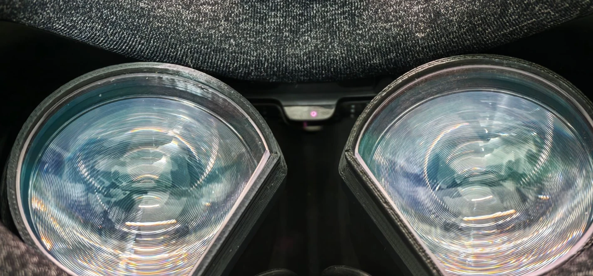

# Valve Index proximity sensor & Beat Saber "starts paused"

English | [简体中文](README.zh-CN.md)

Notes and tools from tracking down why Beat Saber 1.45.x pauses on the first frame of every song on a Valve Index, and why the Index thinks it is not being worn.

*The proximity sensor is the small infrared emitter/receiver window between the lenses, just above the nose.*

## Short version

1. **Beat Saber 1.45.x** pauses whenever OpenXR reports the user as not present (`XR_EXT_user_presence`). The check runs at song start and again when the resume countdown ends, so you get "paused on load, resume, countdown, paused again" forever. 1.44.1 does not do this.
2. **SteamVR** sends `isUserPresent = false` because the **Index HMD firmware** says the headset is not worn.
3. **The Index's decision** comes from a raw infrared reflection count compared with a fixed threshold inside the headset firmware, around **448–450**. On the headset tested, the reading is about 140–180 with nothing in front of it and about 270–440 while worn. Normal wear often does not reach the threshold; pressing the headset closer or putting a finger on the sensor does.
4. There is no SteamVR setting or driver parameter for the threshold. The SteamVR driver only reads `proximity.enable`, and the trigger bit arrives already computed by the headset.

Full evidence chain: [docs/findings.md](docs/findings.md).

## Is this your problem?

- Songs start paused and re-pause after every resume, menus work fine, and downgrading to 1.44.1 fixes it.
- Push your fringe out of the headset and try again. The sensor measures reflected IR, and dark hair in front of it lowers the reading noticeably.
- Put a small piece of opaque tape or a sticker over the sensor window (see photo). If songs now play normally, you are very likely seeing the same thing.
- Or run [`tools/proximity_overlay.py`](tools/proximity_overlay.py) and watch the live reading while wearing the headset.

## Workarounds

| Option | Effect | Downside |
|---|---|---|
| Tape over the sensor | Always "worn" for every app | No auto display-off / standby when you take the headset off |
| Small reflective sticker inside the headset, placed so the idle reading sits just below the threshold and wearing pushes it over | Wear detection works again for every app | Fiddly; aim for roughly ≥ 500 worn and ≤ 350 off, using the overlay while adjusting |
| Steam → Beat Saber → Properties → Betas → 1.44.1 | Old pause logic | Stuck on the old version |
| [PresenceFix](mods/PresenceFix) BSIPA plugin | Beat Saber only: presence is forced to "worn" or decided by your own threshold | Needs a modded game (BSIPA) |

The real fix would be a configurable threshold, but it lives in the HMD firmware. Changing it would mean extracting and patching firmware, which this project does not attempt.

## Tools

All tools are read-only. They do not change SteamVR settings or headset configuration.

| Tool | What it shows |
|---|---|
| [`tools/proximity_overlay.py`](tools/proximity_overlay.py) | A SteamVR overlay below your view with the worn/off state, the raw proximity count, and the value ranges seen on each side of the firmware trigger. `--console` prints to the terminal instead. `--lang zh` switches the labels to Chinese. Requires Pillow. |
| [`tools/openxr_presence_probe.py`](tools/openxr_presence_probe.py) | Opens a render-less OpenXR session (`XR_MND_headless`) and logs `XR_EXT_user_presence` events. This is exactly what Beat Saber receives. |
| [`tools/openvr_presence_probe.py`](tools/openvr_presence_probe.py) | Polls the OpenVR HMD activity level, which follows the proximity sensor on an Index. |
| [`mods/PresenceFix`](mods/PresenceFix) | BSIPA + Harmony plugin for Beat Saber 1.45.x; see its [README](mods/PresenceFix/README.md). |

To close the overlay, press Ctrl+C in its terminal or end the `python` process. SteamVR removes the panel as soon as the process exits, and `--seconds N` makes it exit on its own.

Requirements: Windows, SteamVR running, Python 3.10+ (Pillow for the overlay). Run with `python -I tools/<script>.py`. Paths assume the default Steam library; edit the constants at the top of each script if yours differs.

The raw count comes from SteamVR's own `lighthouse_console.exe`, using only the `serial`, `axis`, `dump` and `sleep` commands. Nothing that writes to the device (`uploadconfig`, `isp`, `reboot`, pairing, …) is ever sent.

## Status

- Tested on one Valve Index, Windows 11, SteamVR OpenXR runtime 2.18.4, Beat Saber 1.45.3.
- Not verified: whether the low reading comes from sensor aging, face shape or face-gasket distance; and a direct comparison with the 1.44.1 binaries.
- Reports from other headsets (Quest via WiVRn, Steam Frame) in the original Reddit thread show the same Beat Saber behavior, but their presence source is different.

Original discussion: [r/beatsaber – Game starts songs paused and won't unpause](https://www.reddit.com/r/beatsaber/comments/1x6aux9/game_starts_songs_paused_and_wont_unpause/).

Beat Saber, SteamVR and Valve Index are trademarks of their respective owners. This repository contains no game or SteamVR binaries or decompiled code.
