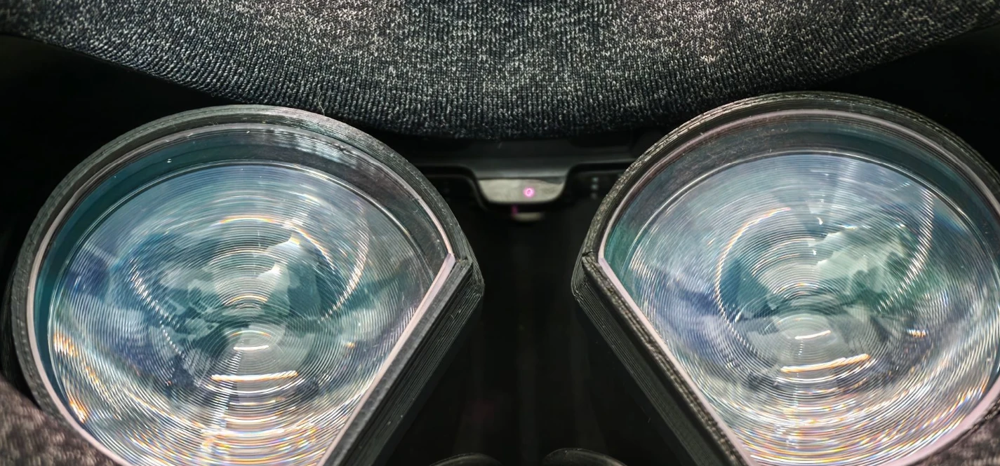

# Valve Index 佩戴传感器与 Beat Saber“进歌即暂停”

[English](README.md) | 简体中文

这里记录了排查过程中的发现和用到的工具。问题是：Beat Saber 1.45.x 在 Valve Index 上每首歌第一帧就暂停；根源是 Index 认为头显没人戴。

*接近传感器是两片镜片之间、鼻梁上方的小红外收发窗口。*

## 结论速览

1. **Beat Saber 1.45.x** 会在 OpenXR 报告“用户不在场”（`XR_EXT_user_presence`）时暂停。开局和“继续”倒计时结束时都会检查一次，于是陷入“进歌暂停 → 继续 → 倒计时 → 又暂停”的循环。1.44.1 读取的是同一个在场值，但只在“佩戴 → 未佩戴”变化的那一刻暂停一次，从不阻止恢复。所以头显一直被报告为“未佩戴”时，1.44.1 不会因此暂停（[详情](docs/findings.zh-CN.md#2-beat-saber在场状态是暂停条件maindll)）。
2. **SteamVR** 发出 `isUserPresent = false`，因为 **Index 头显固件**判定头显未佩戴。
3. **Index 的判定方式**：用红外反射的原始计数和固件里的固定阈值（约 **448–450**）比较。测试的这台头显，无遮挡时读数约 140–180，正常佩戴约 270–440，常常够不着阈值。把头显压紧或用手指贴住传感器才能触发。
4. SteamVR 没有阈值设置，驱动里也没有对应参数。驱动只读 `proximity.enable`，触发位是头显算好后发上来的。

完整证据链见 [docs/findings.zh-CN.md](docs/findings.zh-CN.md)。

## 自查

- 歌曲一开始就暂停，每次继续后又暂停，菜单正常，降级到 1.44.1 就好了。
- 把额前头发拨出头显再试。传感器测的是红外反射强度，深色头发挡在前面会明显拉低读数。
- 用一小块不透光的胶带或贴纸盖住传感器窗口（见上图）。如果歌曲能正常播放，基本就是同一个问题。
- 也可以运行 [`tools/proximity_overlay.py`](tools/proximity_overlay.py)，戴着头显直接看实时读数。

## 规避方案

| 方案 | 效果 | 代价 |
|---|---|---|
| 胶带盖住传感器 | 所有应用都认为一直在佩戴 | 摘下头显后不会自动熄屏和待机 |
| 在头显内侧贴一小块反光贴纸，让无人佩戴时的读数略低于阈值、戴上后超过阈值 | 所有应用的佩戴检测都恢复正常 | 需要反复调整位置；目标大约是佩戴 ≥ 500、摘下 ≤ 350，调整时用覆盖层看读数 |
| Steam → Beat Saber → 属性 → 测试版 → 1.44.1 | 在场状态只在“佩戴 → 未佩戴”变化时暂停一次，不阻止恢复 | 只能停留在旧版本；传感器读数来回跳时，歌曲中途仍可能偶尔暂停 |
| [PresenceFix](mods/PresenceFix) BSIPA 插件 | 仅对 Beat Saber 生效：在场值固定为“佩戴”，或按你自己设的阈值判定 | 需要装 BSIPA 模组环境 |

真正的解决办法是让阈值可以调整，但阈值在头显固件里。修改它需要提取并修改固件，本项目不做这件事。

## 工具

所有工具都只读，不会修改 SteamVR 设置或头显配置。

| 工具 | 作用 |
|---|---|
| [`tools/proximity_overlay.py`](tools/proximity_overlay.py) | 在视野下方显示一个 SteamVR 覆盖层：佩戴/离开状态、原始接近计数，以及固件触发和未触发时各自出现过的读数范围。`--console` 改为只在终端输出，`--lang zh` 显示中文。需要 Pillow。 |
| [`tools/openxr_presence_probe.py`](tools/openxr_presence_probe.py) | 建一个不渲染画面的 OpenXR 会话（`XR_MND_headless`），记录 `XR_EXT_user_presence` 事件，和 Beat Saber 收到的值完全一致。 |
| [`tools/openvr_presence_probe.py`](tools/openvr_presence_probe.py) | 轮询 OpenVR 的头显活动等级；在 Index 上它跟随接近传感器变化。 |
| [`mods/PresenceFix`](mods/PresenceFix) | Beat Saber 1.45.x 的 BSIPA + Harmony 插件，见[插件说明](mods/PresenceFix/README.md)。 |

关闭覆盖层：在它的终端里按 Ctrl+C，或者结束对应的 `python` 进程，进程一退出面板就会消失。也可以用 `--seconds N` 让它到时自动退出。

运行环境：Windows，SteamVR 已启动，Python 3.10+（覆盖层需要 Pillow）。用 `python -I tools/<脚本>.py` 运行。脚本默认 Steam 装在默认库位置；如果不是，改脚本开头的路径常量。

原始计数来自 SteamVR 自带的 `lighthouse_console.exe`，只发送 `serial`、`axis`、`dump`、`sleep` 四个命令，从不发送任何会写入设备的命令（`uploadconfig`、`isp`、`reboot`、配对等）。

## 现状

- 测试环境：一台 Valve Index、Windows 11、SteamVR OpenXR 运行时 2.18.4、Beat Saber 1.45.3 和 1.44.1（两个版本做了静态对比）。
- 尚未确认：读数偏低是传感器老化、脸型还是面垫距离造成的。
- 原帖里用其他头显（Quest + WiVRn、Steam Frame）的玩家也遇到同样的 Beat Saber 现象，但他们的在场信号来源不同。

原帖：[r/beatsaber – Game starts songs paused and won't unpause](https://www.reddit.com/r/beatsaber/comments/1x6aux9/game_starts_songs_paused_and_wont_unpause/)。

Beat Saber、SteamVR、Valve Index 是各自所有者的商标。本仓库不包含游戏或 SteamVR 的二进制文件及反编译代码。
